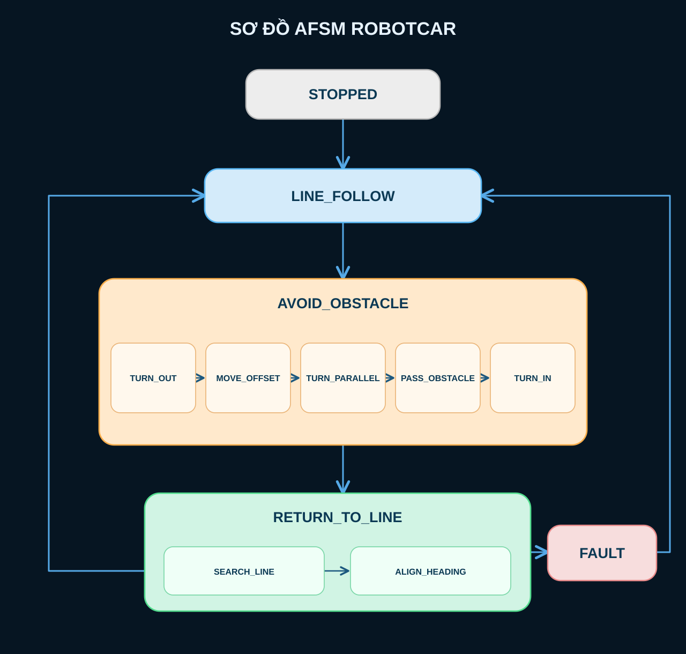

# CW2 – Yêu cầu thiết kế và lập trình RobotCar

> **Phạm vi thực hiện theo yêu cầu mới của giảng viên:** Robot tự **đi theo vạch đen (LINE_FOLLOW)**. Khi có **vật cản trên đường đi**, robot **né vật cản**, **tìm và quay về đúng vạch đen ban đầu**, rồi **tiếp tục LINE_FOLLOW**.

## 1. Phần cứng được cấp

| Thành phần | Số lượng | Vai trò |
|---|---:|---|
| **Romeo V2** | 1 | Vi điều khiển, đọc cảm biến và điều khiển motor |
| **IR Line Sensor** | **2** | Đọc vạch đen và điều chỉnh hướng bám vạch |
| **HC-SR04 Ultrasonic Sensor** | **1** | Phát hiện vật cản phía trước |
| Motor, bánh xe, khung xe, nguồn | Theo bộ xe được cấp | Giúp robot di chuyển |


## 2. Mục tiêu hoạt động

Robot phải thực hiện chuỗi hành vi:

```text
START
  |
  v
[LINE_FOLLOW] -- Gặp vật cản --> [AVOID_OBSTACLE]
     ^                                  |
     |                                  v
     +------ Tìm lại vạch đen --- [RETURN_TO_LINE]
     |
     +---- Tiếp tục bám vạch đen theo hướng ban đầu
```

**Ví dụ:** Robot đang bám vạch đen → HC-SR04 phát hiện vật cản → robot chuyển hướng để đi vòng qua vật cản → tìm lại vạch đen **sau vị trí vật cản** → tiếp tục chạy trên vạch.

## 3. Yêu cầu chức năng

| ID | Chức năng | Yêu cầu đạt |
|---|---|---|
| **FR-01** | `LINE_FOLLOW` | Sử dụng **2 IR** để bám **vạch đen** ổn định trên nền sáng. |
| **FR-02** | `OBSTACLE_DETECTION` | Sử dụng **1 HC-SR04** phát hiện vật cản phía trước khi đang bám vạch. |
| **FR-03** | `AVOID_OBSTACLE` | Khi phát hiện vật cản ở khoảng cách ngưỡng, robot rẽ và đi vòng qua, không va chạm trong tình huống kiểm thử. |
| **FR-04** | `RETURN_TO_LINE` | Sau khi né, robot tìm lại **vạch đen cũ** và điều chỉnh hướng để bám vạch. |
| **FR-05** | `RESUME_LINE_FOLLOW` | Sau khi quay lại vạch, robot tiếp tục `LINE_FOLLOW` theo **hướng đi ban đầu**, không dừng hẳn. |

## 4. Kiến trúc điều khiển

**Kiến trúc áp dụng:** **AFSM (Augmented Finite State Machine)** theo hướng dẫn trong Assignment Brief.

### 4.1. Các State chính

| State | Nhiệm vụ |
|---|---|
| `LINE_FOLLOW` | Đọc IR liên tục, điều chỉnh motor để bám vạch đen. |
| `AVOID_OBSTACLE` | Điều khiển chuỗi rẽ và đi vòng qua vật cản. |
| `RETURN_TO_LINE` | Tìm lại vạch đen, căn chỉnh hướng rồi chuyển về `LINE_FOLLOW`. |

`OBSTACLE_DETECTION` là **điều kiện chuyển State (Trigger)**, không bắt buộc phải tạo thành một State riêng. Có thể chia `AVOID_OBSTACLE` thành các **sub-state** như `TURN_OUT`, `BYPASS`, `TURN_BACK` để điều khiển từng bước bằng timer.

### 4.2. Quy tắc chuyển State

| State hiện tại | Điều kiện | State kế tiếp |
|---|---|---|
| `LINE_FOLLOW` | HC-SR04 báo vật cản gần | `AVOID_OBSTACLE` |
| `AVOID_OBSTACLE` | Đã hoàn tất đoạn đi vòng theo kế hoạch | `RETURN_TO_LINE` |
| `RETURN_TO_LINE` | IR xác nhận tìm lại vạch đen và xe đã căn chỉnh | `LINE_FOLLOW` |

### 4.3. Sơ đồ AFSM mục tiêu



### 4.4. Logic IR minh họa

Giả sử IR được đặt trái và phải, và giá trị đã được **chuẩn hóa** thành `BLACK` hoặc `WHITE`:

| IR trái | IR phải | Điều khiển dự kiến |
|---|---|---|
| BLACK | WHITE | Hiệu chỉnh về phía trái |
| WHITE | BLACK | Hiệu chỉnh về phía phải |
| BLACK | BLACK | Đi thẳng hoặc giữ hướng (tùy cách đặt cảm biến) |
| WHITE | WHITE | Đang mất vạch hoặc ở khoảng trống: tìm lại vạch |

**Chú ý:** Bảng chỉ là **ví dụ ban đầu**; hướng rẽ thực tế phụ thuộc vị trí 2 IR so với vạch. Cần kiểm tra trên xe trước khi dùng chính thức.

## 5. Yêu cầu lập trình

- Cấu trúc chương trình dùng **State**, **Trigger**, **Transition**, có sơ đồ AFSM tương ứng.
- Các hàm điều khiển motor dùng lại được: `forward()`, `turnLeft()`, `turnRight()`, `stopMotor()`.
- Ưu tiên dùng **timer không chặn (non-blocking)** cho các giai đoạn né vật cản.
- Theo hướng dẫn đề gốc, vòng lặp cập nhật điều khiển mục tiêu **0.1 giây (100 ms)**; tránh `sleep()`/`delay()` dài làm robot không đọc cảm biến kịp.
- Tốc độ motor, ngưỡng phát hiện vật cản, thời gian/góc rẽ và quỹ đạo né **phải hiệu chỉnh qua thử nghiệm**, không có giá trị cố định trong yêu cầu mới.
- Với **một HC-SR04**, phương án né bằng chuỗi động tác đã thử nghiệm phù hợp với **bố trí vật cản xác định**; không cam kết né an toàn mọi vật cản.

## 6. Kế hoạch triển khai và kiểm thử

- [ ] **Bước 1:** Xác nhận kết nối **Romeo V2 ↔ 2 IR ↔ HC-SR04 ↔ motor**.
- [ ] **Bước 2:** Test 2 IR trên **vạch đen/nền sáng** và xác định logic `BLACK`/`WHITE`.
- [ ] **Bước 3:** Hoàn thành `LINE_FOLLOW` chạy ổn định **khi chưa có vật cản**.
- [ ] **Bước 4:** Test HC-SR04 và chọn ngưỡng phát hiện vật cản hợp lý.
- [ ] **Bước 5:** Lập trình `AVOID_OBSTACLE` để đi vòng qua vật cản.
- [ ] **Bước 6:** Hoàn thành `RETURN_TO_LINE` để bám lại đúng vạch đen ban đầu.
- [ ] **Bước 7:** Kiểm thử liên tục: **bám vạch → né → quay về vạch → bám tiếp**.
- [ ] **Bước 8:** Vẽ/cập nhật **AFSM Diagram** trùng với các State và Transition trong code, quay video minh họa.

**Tiêu chí nghiệm thu cốt lõi:** Robot hoàn thành chu trình ở Bước 7 mà không cần can thiệp thủ công, với vật cản đặt trên vạch đen trong sân kiểm thử.
