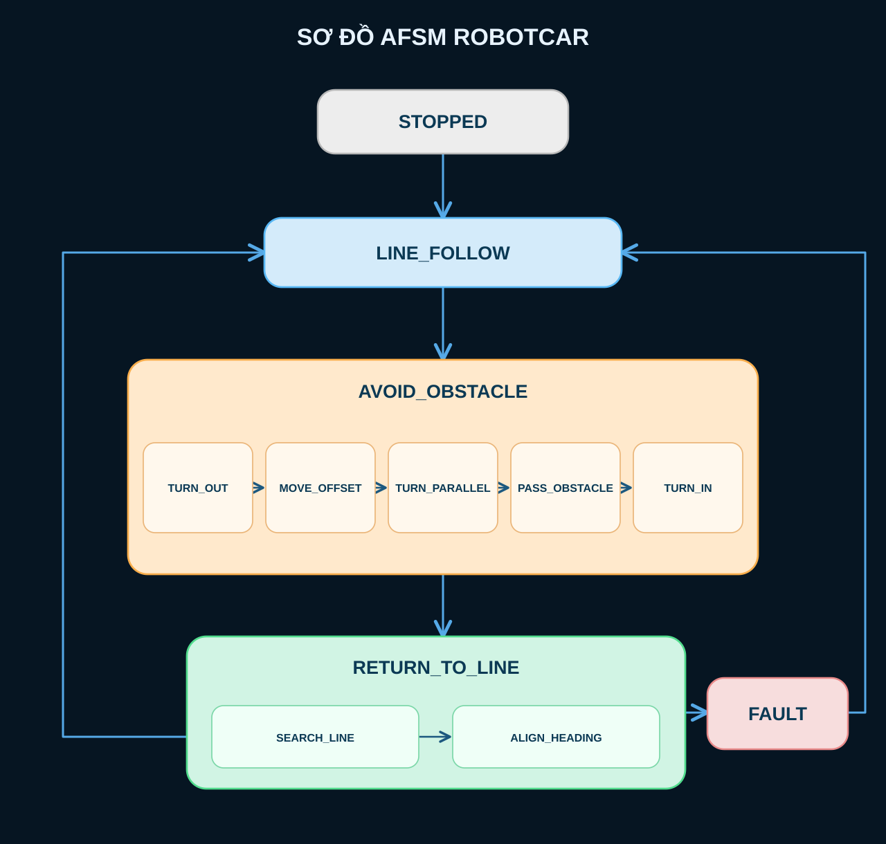

# Báo cáo thiết kế RobotCar

## 1. Robot Control Architecture – Kiến trúc điều khiển

### 1.1. Giới thiệu AFSM

Robot sử dụng **AFSM (Augmented Finite State Machine – máy trạng thái hữu hạn mở rộng)** để tổ chức chương trình điều khiển. Ở mỗi thời điểm, robot chỉ hoạt động trong một trạng thái chính. Hàm `updateRobotAfsm()` chọn hành vi tương ứng với trạng thái hiện tại; dữ liệu cảm biến, nút nhấn và thời gian quyết định thời điểm chuyển sang trạng thái tiếp theo.

Phần “mở rộng” của AFSM gồm các giai đoạn con và thông tin nội bộ phục vụ quyết định chuyển trạng thái. Cách tổ chức này cho phép một trạng thái thực hiện nhiều bước mà vẫn giữ được luồng điều khiển rõ ràng.

### 1.2. Lý do sử dụng AFSM

Nhiệm vụ của robot là bám vạch đen, phát hiện và né vật cản, tìm lại vạch rồi tiếp tục di chuyển. Các hành vi này có điều kiện bắt đầu và kết thúc khác nhau. AFSM giúp tách chúng thành những trạng thái cụ thể, tránh trộn logic đọc cảm biến với chuỗi điều khiển động cơ.

AFSM cũng phù hợp với quá trình né vật cản và tìm lại vạch theo nhiều bước. Mỗi trạng thái có điểm bắt đầu, điều kiện hoàn thành và hướng xử lý khi thất bại. Vì vậy, sơ đồ dễ đối chiếu với chương trình và thuận tiện khi thay đổi từng chức năng.

### 1.3. Sơ đồ AFSM

Sơ đồ thể hiện năm trạng thái chính và các giai đoạn con của quá trình né vật cản, tìm lại vạch. Điều kiện tương ứng với các mũi tên được trình bày bằng bảng ở mục 1.5.

### 1.4. Chức năng của từng trạng thái

| Trạng thái       | Chức năng                                                  |
| ---------------- | ---------------------------------------------------------- |
| `STOPPED`        | Robot dừng và chờ lệnh bắt đầu. Đây là trạng thái ban đầu. |
| `LINE_FOLLOW`    | Robot bám vạch và theo dõi vật cản.                        |
| `AVOID_OBSTACLE` | Robot thực hiện chuỗi động tác đi vòng qua vật cản.        |
| `RETURN_TO_LINE` | Robot tìm lại vạch và khôi phục hướng di chuyển.           |
| `FAULT`          | Robot dừng khi không thể hoàn thành việc tìm lại vạch.     |

### 1.5. Điều kiện chuyển trạng thái

| Trạng thái hiện tại   | Điều kiện                                          | Trạng thái tiếp theo |
| --------------------- | -------------------------------------------------- | -------------------- |
| `LINE_FOLLOW`         | Cảm biến siêu âm xác nhận có vật cản gần           | `AVOID_OBSTACLE`     |
| `AVOID_OBSTACLE`      | Hoàn thành các giai đoạn né vật cản                | `RETURN_TO_LINE`     |
| `RETURN_TO_LINE`      | Xác nhận đã gặp vạch và hoàn thành căn chỉnh hướng | `LINE_FOLLOW`        |
| `RETURN_TO_LINE`      | Quá thời gian tìm vạch                             | `FAULT`              |
| Bất kỳ trạng thái nào | Nhấn S1                                            | `STOPPED`            |
| Bất kỳ trạng thái nào | Nhấn S2                                            | `LINE_FOLLOW`        |

Các ngưỡng cảm biến, thời gian và lệnh điều khiển cụ thể được trình bày ở Phần 2.

## 2. Software Implementation – Triển khai chương trình

### 2.1. Cách chương trình hoạt động

Sau khi khởi động, chương trình cấu hình các chân cảm biến, nút nhấn và động cơ rồi đưa xe về trạng thái dừng. Trong mỗi vòng lặp, robot kiểm tra nút nhấn trước, sau đó thực hiện công việc của trạng thái hiện tại. Khi đang bám vạch, robot vừa điều chỉnh hướng đi vừa kiểm tra vật cản. Nếu phát hiện vật cản, xe chuyển sang chuỗi né; sau khi né xong, xe tìm lại vạch để tiếp tục chạy.

### 2.2. Bám vạch đen

Robot dùng hai cảm biến IR đặt hai bên vạch: bên trái nối A3, bên phải nối A2. Giá trị analog của mỗi cảm biến được quy đổi về khoảng 0–1 theo mức trắng và đen đã hiệu chuẩn. Nếu cả hai cảm biến cùng thấy nền sáng, chương trình coi xe đang nằm giữa vạch và cho hai bánh chạy thẳng ở tốc độ cơ sở.

Khi hai bên đọc khác nhau, chương trình lọc giá trị cảm biến để giảm nhiễu, tính sai lệch giữa bên trái và bên phải, rồi điều chỉnh tốc độ hai bánh theo độ lớn và chiều của sai lệch. Bánh bên này chạy nhanh hơn bánh bên kia sẽ làm xe đổi hướng về phía vạch.

### 2.3. Phát hiện vật cản - Né vật cản

Hai cảm biến siêu âm HC-SR04 dùng để phát hiện vật cản. Robot coi một mẫu là có vật cản khi khoảng cách 15 cm.

Robot né vật cản bằng một chuỗi động tác cố định. Mỗi bước được bắt đầu bằng một lệnh cho động cơ và kết thúc khi thời gian tính từ đầu bước đã đạt giá trị cấu hình:

| Bước               | Chuyển động | Thời gian cấu hình |
| ------------------ | ----------- | -----------------: |
| 1. Rời vạch        | Rẽ phải     |             250 ms |
| 2. Tạo khoảng cách | Đi thẳng    |             500 ms |
| 3. Đi song song    | Rẽ trái     |             250 ms |
| 4. Vượt vật cản    | Đi thẳng    |            1000 ms |
| 5. Quay về vạch    | Rẽ trái     |             250 ms |

Chương trình so sánh thời điểm hiện tại từ `millis()` với thời điểm bắt đầu bước, nên không cần một lệnh chờ dài cho toàn bộ chuỗi né. Sau bước cuối, xe đi thẳng và chuyển sang tìm lại vạch.

### 2.4. Tìm lại vạch và xử lý thất bại

Trong lúc đi về phía vạch, robot tiếp tục đọc hai cảm biến IR. Nếu ít nhất một bên thấy vùng tối vượt ngưỡng đã đặt, xe tạm dừng để xác nhận. Chỉ sau hai mẫu thấy vạch liên tiếp, robot mới rẽ phải để khôi phục hướng đi ban đầu. Khi hoàn thành bước căn hướng, trở lại chế độ bám vạch.

Nếu sau 2500 ms robot vẫn chưa xác nhận được vạch, xe dừng động cơ và chuyển sang trạng thái `FAULT`. Cơ chế này ngăn xe tiếp tục chạy thẳng vô thời hạn khi không tìm được đường đi.

## 5. Testing and Results – Kiểm thử và kết quả

Điền kết quả sau khi thử robot thực tế. Với mỗi ca, ghi điều quan sát được, chọn **Pass** hoặc **Fail** và thêm ảnh/video nếu có.

### 5.1. Điều kiện thử nghiệm

- **Ngày, địa điểm và mặt sàn:** [Điền]
- **Bố trí vạch đen và vật cản:** [Điền; có thể kèm ảnh toàn cảnh]
- **Nguồn cấp và thông số đã hiệu chỉnh:** [Điền]

### 5.2. Các ca kiểm thử

#### TC01 – Bám vạch

- **Cách thử:** Đặt xe trên vạch, nhấn S2 và cho xe chạy qua cả đoạn thẳng lẫn khúc cua.
- **Tiêu chí Pass:** Xe đi theo vạch trên đoạn thẳng, điều chỉnh hướng ở khúc cua và tiếp tục bám vạch sau cua.
- **Quan sát thực tế:** [Điền kết quả ở đoạn thẳng và khúc cua]
- **Kết quả:** [Pass/Fail]
- **Ảnh/video:** [Điền nếu có]

#### TC02 – Phát hiện vật cản

- **Cách thử:** Đặt vật cản trên vạch trong phạm vi phát hiện khoảng 15 cm và quan sát phản ứng của xe.
- **Tiêu chí Pass:** Xe chuyển từ bám vạch sang né vật cản trước khi va chạm.
- **Quan sát thực tế:** [Điền khoảng cách đặt vật cản và phản ứng của xe]
- **Kết quả:** [Pass/Fail]
- **Ảnh/video:** [Điền nếu có]

#### TC03 – Né vật cản và trở lại vạch

- **Cách thử:** Tiếp tục phép thử TC02; quan sát đường đi của xe sau khi bắt đầu né.
- **Tiêu chí Pass:** Xe đi vòng qua vật cản không va chạm, tìm lại vạch và tiếp tục bám vạch theo hướng ban đầu.
- **Quan sát thực tế:** [Điền bước xe thực hiện được, vị trí gặp lại vạch và lỗi nếu có]
- **Kết quả:** [Pass/Fail]
- **Ảnh/video:** [Điền nếu có]

### 5.3. Tổng hợp kết quả

| Nội dung | Kết quả thực tế |
| --- | --- |
| Số ca đã thử | [Điền] / 3 |
| Số ca Pass | [Điền] |
| Số ca Fail | [Điền] |
| Vấn đề cần hiệu chỉnh | [Điền nếu có] |

**Nhận xét chung:** [Sau khi thử, nêu khả năng bám vạch và né vật cản của robot, cùng những điểm còn cần chỉnh sửa.]

## 6. Conclusion – Kết luận

### 6.1. Những chức năng đã hoàn thành

Chương trình đã triển khai chức năng bám vạch đen bằng hai cảm biến IR, phát hiện vật cản bằng hai cảm biến siêu âm, thực hiện chuỗi động tác né vật cản và tìm lại vạch để tiếp tục di chuyển. Robot cũng có lệnh bắt đầu, dừng và trạng thái lỗi khi không tìm được vạch trong thời gian cho phép. Kết quả vận hành thực tế của từng chức năng sẽ được ghi ở Phần 5 sau khi thử nghiệm.

### 6.2. Vấn đề gặp phải

Khó khăn chính là đưa robot trở lại đúng vạch sau khi đi vòng qua vật cản. Quỹ đạo né được tạo từ các lệnh rẽ và đi thẳng với thời gian đặt trước. Nếu vật cản nằm ở vị trí khác so với vị trí dùng để hiệu chỉnh, điểm kết thúc chuỗi né có thể lệch khỏi vạch. Khi đó, robot có thể không tìm lại được vạch và phải dừng ở trạng thái lỗi.

### 6.3. Hạn chế của robot

Robot hiện được cấu hình cho một đường vạch và cách bố trí vật cản cố định. Chương trình chưa tự điều chỉnh quỹ đạo né theo vị trí thực tế của vật cản. Khi chuyển sang một đường vạch khác, cần hiệu chỉnh lại các thông số như giá trị cảm biến, tốc độ động cơ và thời gian chuyển động. Vì vậy, hoạt động của robot chưa thể áp dụng ổn định cho mọi đường chạy hoặc mọi vị trí đặt vật cản.
